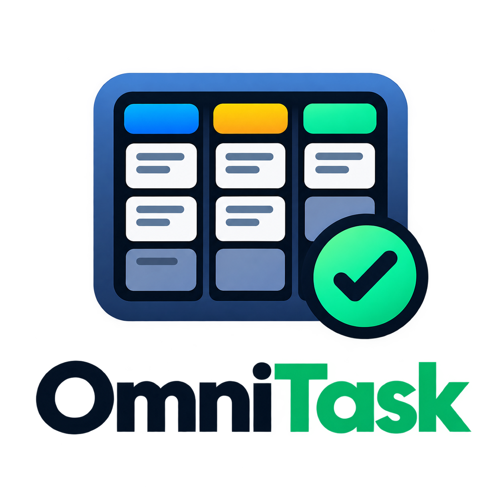

# OmniTask MCP

<p align="center">
  
</p>

Веб-приложение для управления задачами со встроенным MCP-сервером для ИИ-агентов.

- **Бэкенд**: FastAPI + SQLAlchemy (SQLite, WAL), JWT-аутентификация — по адресу `/api`
- **Фронтенд**: React + Vite + Tailwind — собирается в `dist/` и отдаётся как статические файлы
- **MCP**: FastMCP через SSE — по адресам `/sse` и `/messages`
- **Изоляция данных**: полная — доски, задачи, теги, списки и палитра привязаны к пользователю; задачи/теги/списки — дополнительно к своей доске

## Возможности

- **Многодосочность**: у пользователя до 20 досок, каждая со своим набором задач, тегов и списков (кросс-досочное использование запрещено). У доски: имя (до 60 символов), описание и цвет из палитры из 20 пресетов. В хедере — «барабан» досок: активная по центру (клик — редактирование), по бокам соседние (клик — переключение), в конце — карточка «+ Создать доску»; фон дашборда подкрашивается цветом активной доски.
- Регистрация / вход, роли (пользователь / администратор). Первый зарегистрированный пользователь становится администратором.
- Канбан-доска с вертикальными группами по спискам (сворачиваемыми), системные списки «Не начато», «В работе», «Готово», «Архив» (создаются при регистрации) — **все списки редактируемые** (имя, цвет, порядок, статус: todo/progress/done).
- Задачи: приоритет (цветная точка), статус, даты начала/завершения, описание с Markdown, теги (18 цветных пресетов, изолированы по пользователю), блокирующие задачи.
- Даты на карточке — теги-чипы без времени: «12 окт.» (текущий год) / «12 окт. 2027»; серый — день не наступил, оранжевый — сегодня, красный — просрочено. Карточки в «Готово» и «Архив» — бледные.
- Свайп карточки: карточка (со скруглениями и тенью) уезжает, обнажая статичную окрашенную подложку на фоне дашборда с надписью целевого списка. **Свайп вправо — вперёд по спискам**, влево — назад; на крайних списках «за границу» — удаление. После порога текст надписи вспыхивает белым.
- Фильтры дашборда: «Всего задач», «К выполнению», «В работе», «Выполнено», «Просрочено», «Запланировано»; облако тегов. На мобильных фильтры — выпадающее меню, закрывается тапом по дашборду (оверлей блокирует доску).
- Циклические задачи: умная видимость (окно `reminder_days`), интервалы (ежедневно/еженедельно/ежемесячно/ежегодно), кнопки «Выполнено / Пропустить / Остановить / История», история итераций в `task_cycle_logs`.
- Панель администратора (вкладки «Пользователи» и «Веб-хуки»): управление пользователями, роли, разрешение регистрации, генерация/отзыв MCP-токенов; CRUD веб-хуков (пользователь + доска) с кнопкой тестирования.
- **Веб-хуки**: уведомления о событиях задач во внешние системы (например, Telegram через шлюз). Веб-хук привязан к пользователю **и к доске** — уведомления уходят только о событиях задач этой доски. Тело запроса подписывается HMAC-SHA256 (заголовок `X-Hub-Signature-256`). Мгновенные события: `task_created`, `task_updated`, `task_completed`, `task_deleted`, `priority_changed`; фоновый планировщик (каждые 30 минут): `task_overdue`, `deadline_approaching`. Для каждого веб-хука настраиваются включённые и исключённые события (исключённые всегда побеждают).
- Адаптивный интерфейс (мобильные: bottom-sheet модалки, компактные кнопки).
- **PWA**: приложение устанавливается на устройство как веб-приложение (standalone, иконка на рабочем столе). Service Worker обновляется автоматически; API-запросы, `/sse` и `/messages` не кэшируются.

## Безопасность

- `SECRET_KEY` — **обязательная** переменная окружения (приложение не стартует без неё): `python3 -c "import secrets; print(secrets.token_urlsafe(48))"`.
- `CORS_ORIGINS` — список разрешённых origin через запятую; по умолчанию CORS отключён (приложение same-origin).
- `ACCESS_TOKEN_EXPIRE_MINUTES` — срок жизни JWT (по умолчанию 480 минут = 8 ч).
- Bulk-операции не раскрывают внутренние ошибки; `user_id`/`id` защищены от подмены через payload.

## REST API (кратко)

| Домен | Эндпоинты |
|---|---|
| Аутентификация | `GET /api/auth/registration-status`, `POST /api/auth/register`, `POST /api/auth/login`, `GET /api/auth/me` |
| Доски | CRUD `/api/boards` (лимит 20 на пользователя; удаление последней доски запрещено) |
| Задачи | CRUD `/api/tasks?board_id=…`, `POST /api/tasks/bulk`, `POST /api/tasks/{id}/cycle/skip`, `POST /api/tasks/{id}/cycle/stop`, `GET /api/tasks/{id}/cycle/history` |
| Списки и теги | CRUD `/api/lists?board_id=…` + `/api/lists/{board_id}/{id}`, CRUD `/api/tags?board_id=…` + `/api/tags/{board_id}/{id}` |
| Статистика | `GET /api/summary?board_id=…` |
| Администрирование | `GET/PUT /api/admin/settings/...`, CRUD `/api/admin/users`, `POST/DELETE /api/admin/users/{id}/mcp-token`, CRUD `/api/admin/webhooks`, `POST /api/admin/webhooks/{id}/test` (синхронный тест доставки) |
| Диагностика | `GET /api/health` (статус + версия сборки) |

Даты передаются в формате ISO 8601. Все запросы ограничены текущим пользователем (JWT в заголовке `Authorization: Bearer ***`): чужие доски/задачи/теги/списки возвращают 404.

## MCP-инструменты

Все инструменты принимают `auth_token` первым аргументом (MCP-токен генерируется в панели администратора). Инструменты используют тот же сервисный слой, что и REST API, поэтому поведение идентично. Все инструменты работы с задачами требуют `board_id` (получается через `list_boards`):

- `list_boards` — доски текущего пользователя
- `list_tasks(board_id, …)`, `create_task(board_id, …)`, `update_task(board_id, …)`, `delete_task(board_id, …)` — управление задачами (включая циклические поля); даты (`start_date`/`deadline`) принимаются строками «ГГГГ-ММ-ДД» или ISO 8601
- `search_tasks(board_id, query_str)` — поиск по названию/описанию в рамках доски
- `manage_cycle(board_id, task_id, action)` — управление циклом: `complete` / `skip` / `stop` / `history`
- `get_project_summary(board_id)` — сводная статистика доски
- `get_my_profile` — ID и роль текущего пользователя
- `list_all_lists(board_id)` — списки указанной доски

## Тесты

```bash
cd backend && SECRET_KEY=dev python3 -m pytest tests/ -q
```

17 тестов: изоляция данных (два пользователя × все роутеры и MCP-инструменты — чужие данные недоступны) и модуль веб-хуков (CRUD, валидация событий, исключённые события, HMAC-подпись исходящих запросов, дедупликация уведомлений планировщика).

## Демо-аккаунт

На проде создан пользователь `demo` / `demo1234` с набором задач, демонстрирующим функционал (списки, приоритеты, теги, циклические, блокирующие, просрочка, архив).

## Локальная разработка

```bash
SECRET_KEY=<generated> ./scripts/dev.sh
```

Бэкенд на `:8000`, dev-сервер фронтенда на `:5173` (с прокси к API).

## Деплой

- Образ собирается в `ghcr.io/jandoer0/mcp-todo:latest`.
- Развёртывание: хост `podman-svc`, управление через **Podman Quadlet** (systemd-юнит), прокси — Caddy. В quadlet заданы `DATABASE_URL` и `SECRET_KEY`.
- Обновление: `podman pull` + `systemctl --user restart mcp-todo.service`.
- Фронтенд автоматически перезагружается при изменении версии бэкенда (`BUILD_VERSION`), ручная очистка кэша не требуется.

```bash
# Сборка и публикация образа
echo $(cat /home/agent/.ghcr_token) | podman login ghcr.io -u Jandoer0 --password-stdin
podman build -t ghcr.io/jandoer0/mcp-todo:latest .
podman push ghcr.io/jandoer0/mcp-todo:latest

# Обновление на сервере
ssh podman-svc "podman pull ghcr.io/jandoer0/mcp-todo:latest && systemctl --user restart mcp-todo.service"
```
